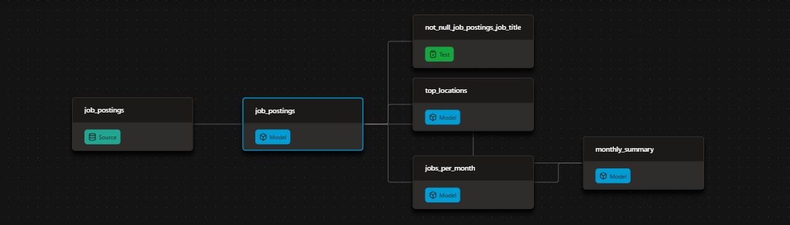

# Automated Job Postings Pipeline (v1) - dbt + DuckDB

A public dbt + DuckDB pipeline over ~692k real job postings, rebuilt and republished automatically on every push

- Models the raw postings into tested, documented insight marts
- Publishes the docs site and the finished warehouse - open to anyone, no credentials
- Runs itself on GitHub Actions: every push and every Monday

> **v1 of this pipeline** - everything free and local-friendly: DuckDB as the warehouse, GitHub Action as the scheduler. [v2](../project_2/) rebuilds it production-grade on Databricks.

# ⚙️ The dbt Pipeline
